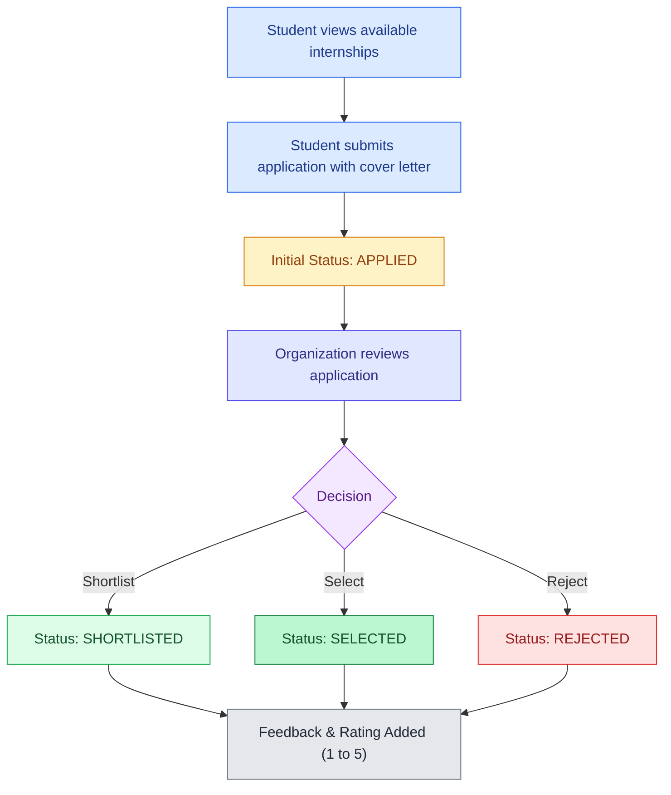
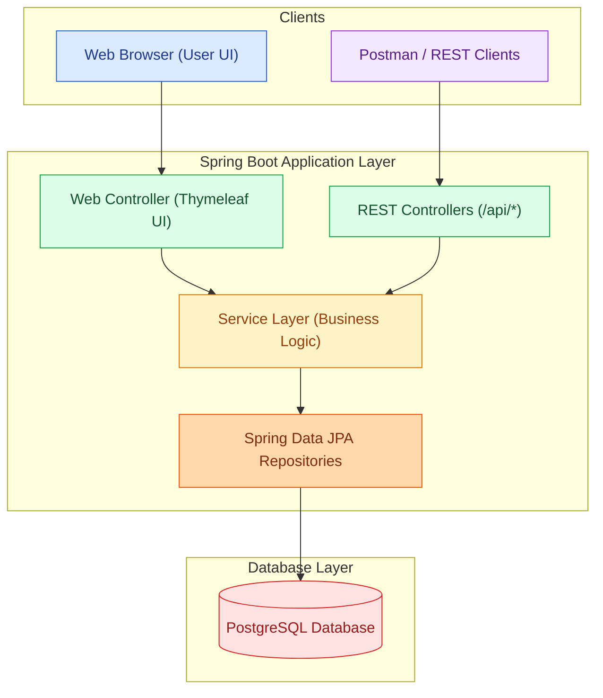
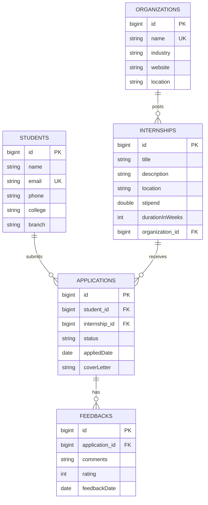

# Internship Tracking System

A full-stack web application that helps students apply for internships and enables organizations to post openings, review applicants, track application statuses, and provide feedback.

---

## Project Details

- **Project:** Internship Tracking System
- **Project Number:** 15
- **Practical Batch:** H11
- **Group Number:** 55

### Group Members

| Roll Number | Name |
|---|---|
| 23359 | Vivek Kalbhor |
| 23362 | Aaryan Adgudwar |
| 23366 | Mayank Patel |
| 23367 | Jayesh Patil |

---

## Problem Statement

Finding internships and tracking applications often becomes disorganized. Students lack clear visibility into whether their applications have been reviewed, while recruiters find it hard to manage applicant pools and share feedback.

The **Internship Tracking System** solves this with:
- **Centralized Data:** Manage students, companies, and internship listings in one place.
- **Transparent Status Tracking:** Clear progression stages (`APPLIED` → `SHORTLISTED` → `SELECTED` / `REJECTED`).
- **Structured Feedback:** Recruiters can submit ratings (1 to 5) and feedback notes for each application.
- **Two Ways to Use:** An interactive web portal (Thymeleaf) and a full REST API with input validation.

---

## Features

| Feature | Description |
|---|---|
| **Student Management** | Register and manage student profiles (name, email, phone, college, and branch). |
| **Organization Management** | Add and manage company profiles (name, industry, website, and location). |
| **Internship Listings** | Post, view, update, and remove internship opportunities for each company. |
| **Application System** | Students can apply with a cover letter and track application submission dates. |
| **Status Updates** | Track and update progress: `APPLIED`, `SHORTLISTED`, `SELECTED`, and `REJECTED`. |
| **Reviews & Feedback** | Record recruiter ratings (1–5 stars) and review comments per application. |
| **Web Dashboard** | Clean web interface with summary statistics and quick action forms. |
| **REST API** | Full CRUD endpoints with validation and clear JSON error responses. |
| **PostgreSQL Database** | Persistent relational storage using Spring Data JPA and Hibernate. |

---

## Application Workflow



---

## System Architecture



---

## Database Schema (ER Diagram)

The database consists of five main entities linked by foreign keys:



---

## Application Status Lifecycle

| Status | Meaning |
|---|---|
| `APPLIED` | The application has been submitted by the student. |
| `SHORTLISTED` | The student passed initial screening and moved to the interview round. |
| `SELECTED` | The student was offered the internship position. |
| `REJECTED` | The application was not selected. |

---

## Technologies Used

- **Backend:** Java 17, Spring Boot 3
- **Database & ORM:** PostgreSQL, Spring Data JPA, Hibernate
- **Frontend / Views:** Thymeleaf, HTML5, CSS3
- **Validation:** Jakarta Bean Validation (`hibernate-validator`)
- **Build Tool:** Maven (Maven Wrapper included)
- **API Testing:** Postman
- **Diagrams:** Mermaid.js

---

## Project Structure

```text
internship-tracker/
├── .mvn/                                # Maven wrapper configuration
├── .postman/                            # Postman workspace configuration
├── postman/                             # Postman collection & environment files
├── src/
│   ├── main/
│   │   ├── java/com/internship/internship_tracker/
│   │   │   ├── InternshipTrackerApplication.java
│   │   │   ├── controller/
│   │   │   │   ├── ApplicationController.java   # REST endpoints for applications
│   │   │   │   ├── FeedbackController.java      # REST endpoints for reviews/feedback
│   │   │   │   ├── InternshipController.java    # REST endpoints for internship listings
│   │   │   │   ├── OrganizationController.java  # REST endpoints for companies
│   │   │   │   ├── StudentController.java       # REST endpoints for students
│   │   │   │   └── WebController.java           # Web UI view routes
│   │   │   ├── dto/
│   │   │   │   ├── ApplicationRequest.java
│   │   │   │   └── StatusUpdateRequest.java
│   │   │   ├── exception/
│   │   │   │   ├── GlobalExceptionHandler.java  # Centralized error handler
│   │   │   │   └── ResourceNotFoundException.java
│   │   │   ├── model/
│   │   │   │   ├── Application.java
│   │   │   │   ├── ApplicationStatus.java       # APPLIED, SHORTLISTED, SELECTED, REJECTED
│   │   │   │   ├── Feedback.java
│   │   │   │   ├── Internship.java
│   │   │   │   ├── Organization.java
│   │   │   │   └── Student.java
│   │   │   ├── repository/                      # JPA Repository interfaces
│   │   │   └── service/                         # Business logic services
│   │   └── resources/
│   │       ├── application.properties           # Database & server configuration
│   │       ├── static/css/style.css             # Custom styles
│   │       └── templates/                       # Thymeleaf templates
│   │           ├── applications.html
│   │           ├── dashboard.html
│   │           ├── internships.html
│   │           ├── organizations.html
│   │           ├── students.html
│   │           └── fragments/navbar.html
│   └── test/                                    # Unit and integration tests
├── mvnw / mvnw.cmd                              # Maven wrapper scripts
├── pom.xml                                      # Maven dependencies and build settings
└── README.md
```

---

## Setup and Installation

### 1. Prerequisites

Make sure you have installed:
- **Java Development Kit (JDK) 17** or higher
- **PostgreSQL 14+**
- **Git**

### 2. Clone the Repository

```bash
git clone https://github.com/JVP008/Internship-Tracker.git
cd Internship-Tracker/internship-tracker
```

### 3. Create the Database

Open PostgreSQL (using `psql` or pgAdmin) and create the database:

```sql
CREATE DATABASE "Internship_Tracker";
```

### 4. Configure Application Properties

Open `src/main/resources/application.properties` and verify your PostgreSQL port and password:

```properties
spring.application.name=internship-tracker

# Default port is 5432 (or your custom port like 1111)
spring.datasource.url=jdbc:postgresql://localhost:5432/Internship_Tracker
spring.datasource.username=postgres
spring.datasource.password=YOUR_POSTGRES_PASSWORD

spring.jpa.hibernate.ddl-auto=update
spring.jpa.show-sql=true
spring.jpa.properties.hibernate.format_sql=true
```

### 5. Run the Project

**Windows (PowerShell / Command Prompt):**
```powershell
.\mvnw.cmd spring-boot:run
```

**Linux / macOS:**
```bash
chmod +x ./mvnw
./mvnw spring-boot:run
```

Once started, open your browser at:
[http://localhost:8080/](http://localhost:8080/)

---

## Web Portal Pages

| Page | URL | What you can do |
|---|---|---|
| **Dashboard** | `/` | View total counts (students, companies, internships, applications) and recent applications. |
| **Students** | `/students` | Browse registered students, add new students, and delete student records. |
| **Organizations** | `/organizations` | View company list, add new organizations, and delete records. |
| **Internships** | `/internships` | Browse posted internships, add new opportunities under an organization, and delete postings. |
| **Applications** | `/applications` | Apply for internships, update application status (`APPLIED` → `SHORTLISTED` → `SELECTED` / `REJECTED`), add ratings and feedback, and delete applications. |

---

## REST API Reference

All endpoints accept and return JSON payloads.

### 1. Students (`/api/students`)

| Method | Endpoint | Description |
|---|---|---|
| `GET` | `/api/students` | Get all students |
| `GET` | `/api/students/{id}` | Get student by ID |
| `POST` | `/api/students` | Register a new student |
| `PUT` | `/api/students/{id}` | Update student details |
| `DELETE` | `/api/students/{id}` | Delete a student |

### 2. Organizations (`/api/organizations`)

| Method | Endpoint | Description |
|---|---|---|
| `GET` | `/api/organizations` | Get all organizations |
| `GET` | `/api/organizations/{id}` | Get organization by ID |
| `POST` | `/api/organizations` | Add a new organization |
| `PUT` | `/api/organizations/{id}` | Update organization details |
| `DELETE` | `/api/organizations/{id}` | Delete an organization |

### 3. Internships (`/api/internships`)

| Method | Endpoint | Description |
|---|---|---|
| `GET` | `/api/internships` | Get all internships |
| `GET` | `/api/internships/{id}` | Get internship by ID |
| `POST` | `/api/internships?organizationId={id}` | Post an internship under an organization |
| `PUT` | `/api/internships/{id}` | Update internship details |
| `DELETE` | `/api/internships/{id}` | Delete an internship |

### 4. Applications (`/api/applications`)

| Method | Endpoint | Description |
|---|---|---|
| `GET` | `/api/applications` | Get all applications |
| `GET` | `/api/applications/{id}` | Get application by ID |
| `GET` | `/api/applications/student/{studentId}` | Get applications submitted by a specific student |
| `GET` | `/api/applications/internship/{internshipId}` | Get applications received for a specific internship |
| `POST` | `/api/applications` | Apply for an internship (`studentId`, `internshipId`, `coverLetter`) |
| `PATCH` | `/api/applications/{id}/status` | Update application status (`status`: `APPLIED`, `SHORTLISTED`, `SELECTED`, `REJECTED`) |
| `DELETE` | `/api/applications/{id}` | Delete an application |

### 5. Feedbacks (`/api/feedbacks`)

| Method | Endpoint | Description |
|---|---|---|
| `GET` | `/api/feedbacks` | Get all feedback entries |
| `GET` | `/api/feedbacks/{id}` | Get feedback by ID |
| `GET` | `/api/feedbacks/application/{applicationId}` | Get feedback for a specific application |
| `POST` | `/api/feedbacks?applicationId={id}` | Add review feedback (`comments`, `rating`: 1 to 5) |
| `DELETE` | `/api/feedbacks/{id}` | Delete feedback entry |

---

## Example API Payloads

### Create Student
```http
POST /api/students
Content-Type: application/json

{
  "name": "Jayesh Patil",
  "email": "jayesh@example.com",
  "phone": "+91 9876543210",
  "college": "MIT Academy of Engineering",
  "branch": "Computer Engineering"
}
```

### Create Organization
```http
POST /api/organizations
Content-Type: application/json

{
  "name": "Google",
  "industry": "Information Technology",
  "website": "https://careers.google.com",
  "location": "Bangalore, India"
}
```

### Post an Internship
```http
POST /api/internships?organizationId=1
Content-Type: application/json

{
  "title": "Software Engineering Intern",
  "description": "Work on backend services using Java and Spring Boot.",
  "location": "Bangalore (Hybrid)",
  "stipend": 45000.0,
  "durationInWeeks": 12
}
```

### Submit Application
```http
POST /api/applications
Content-Type: application/json

{
  "studentId": 1,
  "internshipId": 1,
  "coverLetter": "I have solid foundational knowledge in Java and Spring Boot and would love to contribute."
}
```

### Update Status
```http
PATCH /api/applications/1/status
Content-Type: application/json

{
  "status": "SHORTLISTED"
}
```

### Add Feedback
```http
POST /api/feedbacks?applicationId=1
Content-Type: application/json

{
  "comments": "Strong analytical problem-solving skills in the technical round.",
  "rating": 5
}
```

---

## Error Handling & Validation

Common errors return clean, predictable JSON responses:

- **Resource Not Found (`404 NOT FOUND`):**
  ```json
  {
    "timestamp": "2026-10-24T21:00:00",
    "status": 404,
    "error": "Not Found",
    "message": "Student not found with id: 99"
  }
  ```
- **Validation Error (`400 BAD REQUEST`):**
  ```json
  {
    "timestamp": "2026-10-24T21:00:00",
    "status": 400,
    "error": "Validation Failed",
    "messages": {
      "email": "Email should be valid",
      "rating": "Rating must be between 1 and 5"
    }
  }
  ```

---

## Testing

Run unit and integration tests using Maven:

**Windows:**
```powershell
.\mvnw.cmd clean test
```

**Linux / macOS:**
```bash
./mvnw clean test
```

### Testing with Postman
A configured Postman workspace is included under the [postman/](file:///postman) folder. You can import it directly into Postman to test all endpoints with predefined requests.

---

## Future Scope

- User authentication with role-based access (Student vs Recruiter) using Spring Security and JWT.
- Email notifications when an application status changes.
- Resume upload support (PDF format).
- Search, filter, and pagination for internship listings.
- Application deadlines and automatic expiration.

---

## Contributors

Developed as part of **Practical Batch H11, Group 55**:

| Roll Number | Contributor |
|---|---|
| 23359 | Vivek Kalbhor |
| 23362 | Aaryan Adgudwar |
| 23366 | Mayank Patel |
| 23367 | Jayesh Patil |
