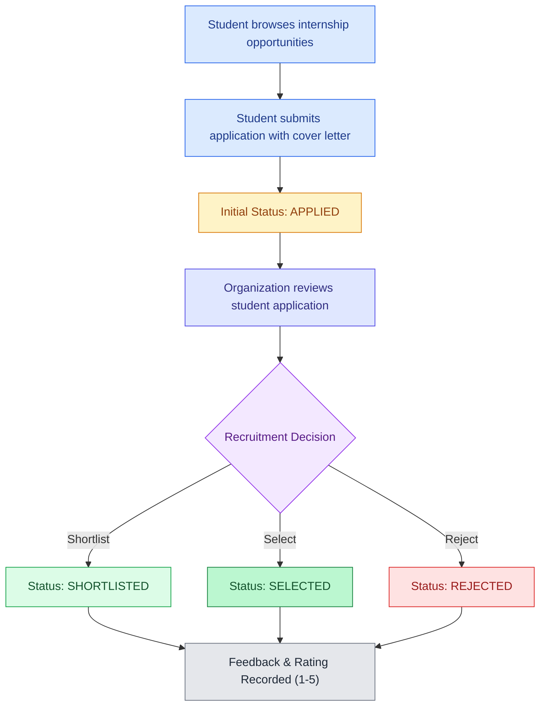
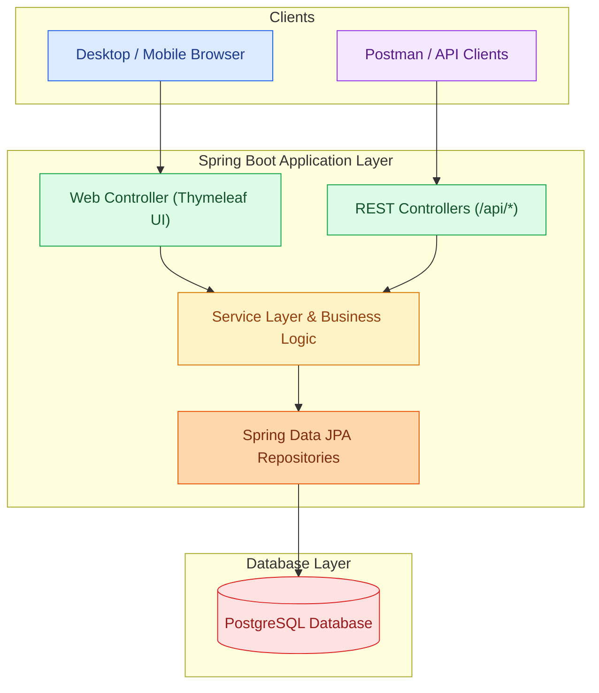
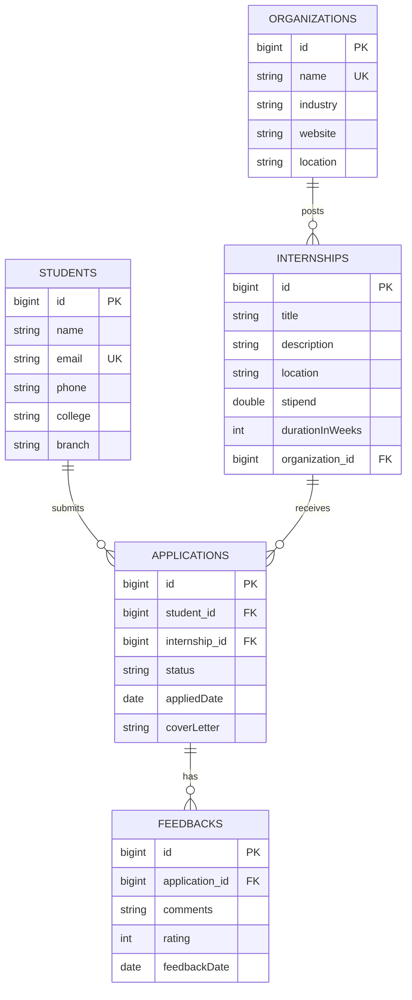

# Internship Tracking System

A full-stack web application designed to help students discover and apply for internship opportunities, while enabling organizations to manage listings, evaluate applicants, update application statuses, and provide constructive feedback.

---

## Project Details

- **Project:** Internship Tracking System
- **Project Number:** 15
- **Practical Batch:** H11
- **Group Number:** 55

### Group Members

| Roll Number | Name |
|---|---|
| 23359 | Vivek Kalbhor |
| 23362 | Aaryan Adgudwar |
| 23366 | Mayank Patel |
| 23367 | Jayesh Patil |

---

## Problem Statement

Navigating internship recruitment often involves fragmented communication between applicants and recruiters. Students lack clear visibility into application statuses and feedback, while organizations face challenges managing applicant pipelines manually.

The **Internship Tracking System** streamlines this workflow by offering:
- Centralized student, organization, and listing registries.
- Transparent application state machine (`APPLIED` → `SHORTLISTED` → `SELECTED` / `REJECTED`).
- Qualitative and quantitative feedback recording.
- Dual access channels: interactive server-side rendered UI (Thymeleaf) and a complete RESTful API with validation.

---

## Features

| Feature | Description |
|---|---|
| **Student Management** | Register and manage student profiles (name, email, phone, college, and branch). |
| **Organization Management** | Register and maintain corporate profiles (name, industry, website, and location). |
| **Internship Listings** | Create, view, update, and remove internship opportunities linked to organizations. |
| **Application Pipeline** | Students apply for opportunities with custom cover letters and track dates. |
| **Status Progression** | Update application states through `APPLIED`, `SHORTLISTED`, `SELECTED`, and `REJECTED`. |
| **Review & Feedback** | Record ratings (1 to 5) and recruiter review comments per application. |
| **Responsive Web Portal** | Clean server-rendered Thymeleaf user interface with real-time statistics dashboard. |
| **REST API & Validation** | Full CRUD endpoints with Jakarta Bean Validation and centralized error handling. |
| **PostgreSQL Integration** | Relational persistence with Spring Data JPA and Hibernate automated schema management. |

---

## Application Workflow



---

## System Architecture



---

## Database Schema (ER Diagram)

The underlying schema models five relational entities with foreign keys and cascade delete rules:



---

## Application Status Lifecycle

| Status | Meaning |
|---|---|
| `APPLIED` | Default status when a student submits an application. |
| `SHORTLISTED` | The student passed preliminary review and moved to interview/evaluation. |
| `SELECTED` | The applicant has been offered the internship position. |
| `REJECTED` | The application has been declined. |

---

## Technologies Used

- **Backend:** Java 17, Spring Boot 3.x
- **Persistence:** Spring Data JPA, Hibernate, PostgreSQL
- **Web UI:** Thymeleaf, HTML5, CSS3
- **Validation:** Jakarta Bean Validation (`hibernate-validator`)
- **Build & Dependency Tool:** Maven (with Maven Wrapper `mvnw`)
- **API Testing:** Postman (`postman/` collection workspace included)
- **Documentation:** Markdown, Mermaid.js

---

## Project Structure

```text
internship-tracker/
├── .mvn/                                # Maven wrapper configuration
├── .postman/                            # Postman workspace resources
├── postman/                             # Postman collection & environment definitions
├── src/
│   ├── main/
│   │   ├── java/com/internship/internship_tracker/
│   │   │   ├── InternshipTrackerApplication.java
│   │   │   ├── controller/
│   │   │   │   ├── ApplicationController.java   # REST API for Applications
│   │   │   │   ├── FeedbackController.java      # REST API for Feedback
│   │   │   │   ├── InternshipController.java    # REST API for Internships
│   │   │   │   ├── OrganizationController.java  # REST API for Organizations
│   │   │   │   ├── StudentController.java       # REST API for Students
│   │   │   │   └── WebController.java           # Thymeleaf Web UI routes
│   │   │   ├── dto/
│   │   │   │   ├── ApplicationRequest.java
│   │   │   │   └── StatusUpdateRequest.java
│   │   │   ├── exception/
│   │   │   │   ├── GlobalExceptionHandler.java  # Centralized REST error handling
│   │   │   │   └── ResourceNotFoundException.java
│   │   │   ├── model/
│   │   │   │   ├── Application.java
│   │   │   │   ├── ApplicationStatus.java       # Enum: APPLIED, SHORTLISTED, SELECTED, REJECTED
│   │   │   │   ├── Feedback.java
│   │   │   │   ├── Internship.java
│   │   │   │   ├── Organization.java
│   │   │   │   └── Student.java
│   │   │   ├── repository/                      # Spring Data JPA Repositories
│   │   │   └── service/                         # Business logic services
│   │   └── resources/
│   │       ├── application.properties           # Database & server configuration
│   │       ├── static/css/style.css             # UI styling
│   │       └── templates/                       # Thymeleaf HTML views
│   │           ├── applications.html
│   │           ├── dashboard.html
│   │           ├── internships.html
│   │           ├── organizations.html
│   │           ├── students.html
│   │           └── fragments/navbar.html
│   └── test/                                    # Unit and integration test cases
├── mvnw / mvnw.cmd                              # Maven wrapper scripts
├── pom.xml                                      # Project dependencies & build config
└── README.md
```

---

## Setup and Installation

### 1. Prerequisites

Ensure you have the following installed on your machine:
- **Java Development Kit (JDK) 17** or higher
- **PostgreSQL 14+**
- **Git**
- **Maven** (optional, wrapper is included)

### 2. Clone the Repository

```bash
git clone https://github.com/JVP008/Internship-Tracker.git
cd Internship-Tracker/internship-tracker
```

### 3. Setup PostgreSQL Database

Access your PostgreSQL instance (via `psql` or pgAdmin) and create the database:

```sql
CREATE DATABASE "Internship_Tracker";
```

### 4. Configure Application Properties

Review and edit [application.properties](file:///src/main/resources/application.properties) with your database port and credentials:

```properties
spring.application.name=internship-tracker

# Default PostgreSQL port is 5432 (or your custom port, e.g. 1111)
spring.datasource.url=jdbc:postgresql://localhost:5432/Internship_Tracker
spring.datasource.username=postgres
spring.datasource.password=YOUR_POSTGRES_PASSWORD

spring.jpa.hibernate.ddl-auto=update
spring.jpa.show-sql=true
spring.jpa.properties.hibernate.format_sql=true
```

> [!IMPORTANT]
> Never commit confidential database passwords to public repositories.

### 5. Build and Run the Application

**Windows (PowerShell / Command Prompt):**
```powershell
.\mvnw.cmd spring-boot:run
```

**Linux / macOS:**
```bash
chmod +x ./mvnw
./mvnw spring-boot:run
```

The application starts by default at `http://localhost:8080/`.

---

## Web Portal Pages

Access the interactive web application via your browser:

| View | Route | Functionality |
|---|---|---|
| **Dashboard** | `GET /` | Key statistics cards (totals of students, orgs, internships, applications) and recent application stream. |
| **Students** | `GET /students` | Student directory table, registration form (name, email, phone, college, branch), and delete action. |
| **Organizations** | `GET /organizations` | Organization listings, company creation form (industry, website, location), and delete action. |
| **Internships** | `GET /internships` | Internship catalog cards, create listing form linked to an organization, and delete action. |
| **Applications** | `GET /applications` | Submit new application, live status badge updater (`APPLIED` → `SHORTLISTED` → `SELECTED` / `REJECTED`), feedback submission with ratings, and deletion. |

---

## Complete REST API Reference

All REST endpoints accept and return `application/json` responses.

### 1. Students (`/api/students`)

| Method | Endpoint | Description |
|---|---|---|
| `GET` | `/api/students` | Get all registered students |
| `GET` | `/api/students/{id}` | Get student details by ID |
| `POST` | `/api/students` | Register a new student |
| `PUT` | `/api/students/{id}` | Update existing student profile |
| `DELETE` | `/api/students/{id}` | Delete student record |

### 2. Organizations (`/api/organizations`)

| Method | Endpoint | Description |
|---|---|---|
| `GET` | `/api/organizations` | Get all organizations |
| `GET` | `/api/organizations/{id}` | Get organization by ID |
| `POST` | `/api/organizations` | Register a new organization |
| `PUT` | `/api/organizations/{id}` | Update organization profile |
| `DELETE` | `/api/organizations/{id}` | Delete organization record |

### 3. Internships (`/api/internships`)

| Method | Endpoint | Description |
|---|---|---|
| `GET` | `/api/internships` | Get all posted internships |
| `GET` | `/api/internships/{id}` | Get internship details by ID |
| `POST` | `/api/internships?organizationId={id}` | Post internship under an organization |
| `PUT` | `/api/internships/{id}` | Update internship details |
| `DELETE` | `/api/internships/{id}` | Delete internship posting |

### 4. Applications (`/api/applications`)

| Method | Endpoint | Description |
|---|---|---|
| `GET` | `/api/applications` | List all applications |
| `GET` | `/api/applications/{id}` | Get application details by ID |
| `GET` | `/api/applications/student/{studentId}` | Get all applications submitted by a student |
| `GET` | `/api/applications/internship/{internshipId}` | Get all applications for a specific internship |
| `POST` | `/api/applications` | Submit application (`studentId`, `internshipId`, `coverLetter`) |
| `PATCH` | `/api/applications/{id}/status` | Update application status (`status`: `APPLIED`, `SHORTLISTED`, `SELECTED`, `REJECTED`) |
| `DELETE` | `/api/applications/{id}` | Withdraw / delete application |

### 5. Feedbacks (`/api/feedbacks`)

| Method | Endpoint | Description |
|---|---|---|
| `GET` | `/api/feedbacks` | List all feedback entries |
| `GET` | `/api/feedbacks/{id}` | Get feedback by ID |
| `GET` | `/api/feedbacks/application/{applicationId}` | Get feedback entries for a specific application |
| `POST` | `/api/feedbacks?applicationId={id}` | Submit review feedback (`comments`, `rating`: 1 to 5) |
| `DELETE` | `/api/feedbacks/{id}` | Delete feedback entry |

---

## Example API Payloads

### Create Student
```http
POST /api/students
Content-Type: application/json

{
  "name": "Jayesh Patil",
  "email": "jayesh@example.com",
  "phone": "+91 9876543210",
  "college": "MIT Academy of Engineering",
  "branch": "Computer Engineering"
}
```

### Create Organization
```http
POST /api/organizations
Content-Type: application/json

{
  "name": "Google",
  "industry": "Information Technology",
  "website": "https://careers.google.com",
  "location": "Bangalore, India"
}
```

### Post Internship Opportunity
```http
POST /api/internships?organizationId=1
Content-Type: application/json

{
  "title": "Software Engineering Intern",
  "description": "Work on distributed cloud backend services using Java & Spring Boot.",
  "location": "Bangalore (Hybrid)",
  "stipend": 45000.0,
  "durationInWeeks": 12
}
```

### Submit Application
```http
POST /api/applications
Content-Type: application/json

{
  "studentId": 1,
  "internshipId": 1,
  "coverLetter": "I have solid foundational knowledge in Java and Spring Boot and would love to contribute."
}
```

### Update Application Status
```http
PATCH /api/applications/1/status
Content-Type: application/json

{
  "status": "SHORTLISTED"
}
```

### Record Application Feedback
```http
POST /api/feedbacks?applicationId=1
Content-Type: application/json

{
  "comments": "Strong analytical problem-solving skills shown in technical interview.",
  "rating": 5
}
```

---

## Error Handling & Validation

Centralized error handling is managed via `GlobalExceptionHandler`:

- **Entity Not Found (`404 NOT FOUND`):**
  ```json
  {
    "timestamp": "2026-10-24T21:00:00",
    "status": 404,
    "error": "Not Found",
    "message": "Student not found with id: 99"
  }
  ```
- **Validation Errors (`400 BAD REQUEST`):**
  ```json
  {
    "timestamp": "2026-10-24T21:00:00",
    "status": 400,
    "error": "Validation Failed",
    "messages": {
      "email": "Email should be valid",
      "rating": "Rating must be between 1 and 5"
    }
  }
  ```

---

## Testing

Run unit and integration tests using Maven:

**Windows:**
```powershell
.\mvnw.cmd clean test
```

**Linux / macOS:**
```bash
./mvnw clean test
```

### Postman Testing
The repository includes a configured Postman workspace under [postman/](file:///postman) and [.postman/](file:///.postman). You can import the collection directly into Postman to test all endpoints.

---

## Future Scope

- Role-based access control (RBAC) and JWT authentication for Students and Recruiters.
- Automated email alerts on status changes and interview invitations.
- PDF resume upload and cloud storage integration (AWS S3 / Firebase Storage).
- Search, filter, and pagination capabilities for listings.
- Application deadline timers and automated expiration.

---

## Contributors

Developed as part of **Practical Batch H11, Group 55**:

| Roll Number | Contributor |
|---|---|
| 23359 | Vivek Kalbhor |
| 23362 | Aaryan Adgudwar |
| 23366 | Mayank Patel |
| 23367 | Jayesh Patil |
