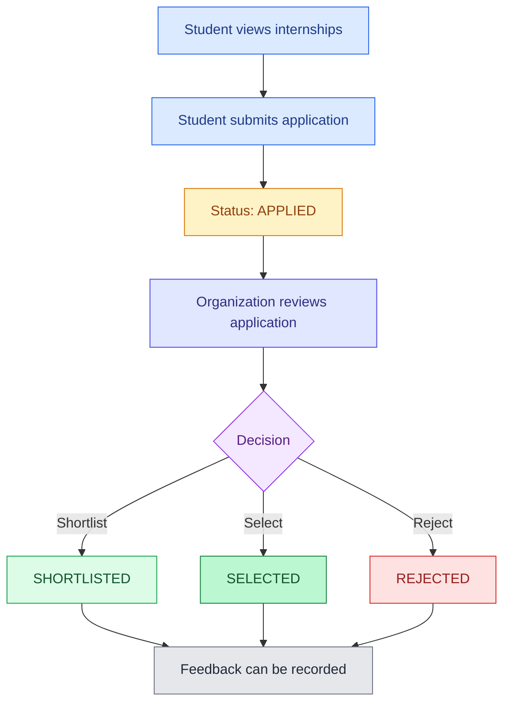
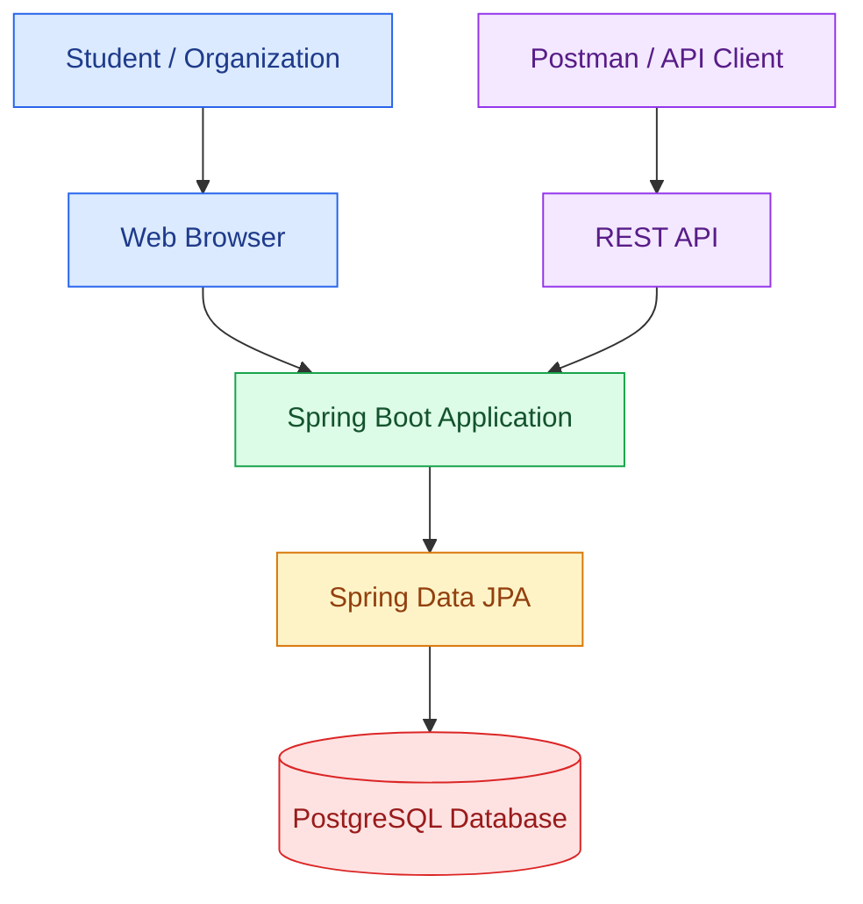
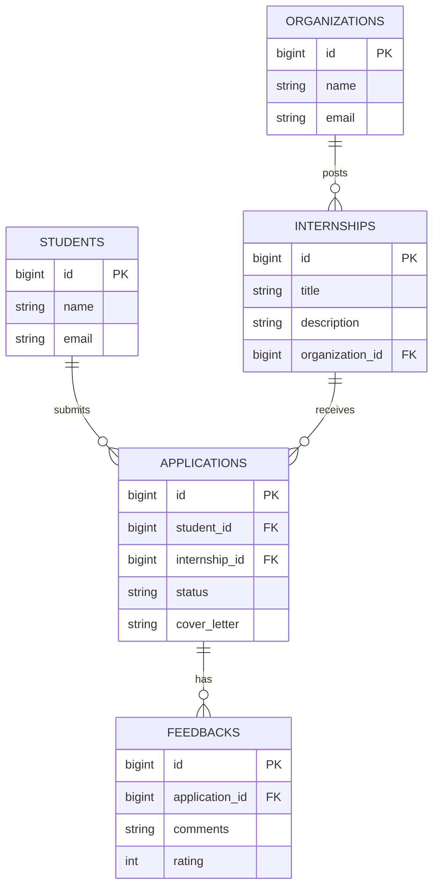

# Internship Tracking System

A simple web application that helps students apply for internships and helps organizations manage applications, track application status, and provide feedback.

## Project Details

- **Project:** Internship Tracking System
- **Project Number:** 15
- **Practical Batch:** H11
- **Group Number:** 55

### Group Members

| Roll Number | Name |
|---|---|
| 23359 | Vivek Kalbhor |
| 23362 | Aaryan Adgudwar |
| 23366 | Mayank Patel |
| 23367 | Jayesh Patil |

---

## Problem Statement

Students need a simple way to find and apply for internships. Organizations need a system to manage internship listings, review applications, update application statuses, and provide feedback.

The Internship Tracking System provides a centralized platform for managing this process.

## Features

| Feature | Description |
|---|---|
| Student Management | Store and manage student details. |
| Organization Management | Store and manage organization details. |
| Internship Listings | Organizations can create internship opportunities. |
| Applications | Students can apply for available internships. |
| Status Tracking | Track application progress and decisions. |
| Feedback | Organizations can provide feedback on applications. |
| REST API | Access application data through REST endpoints. |
| Database Integration | Store application data in PostgreSQL. |

---

## How It Works

The following diagram shows the internship application process.



## System Architecture

The web browser and API client communicate with the Spring Boot application. The application uses PostgreSQL to store and retrieve data.



## Database Relationships (ER Diagram)

The database contains five main entities: students, organizations, internships, applications, and feedback.



*Note: The fields shown are illustrative. Confirm that they match your actual JPA entity classes.*

## Application Status

| Status | Meaning |
|---|---|
| `APPLIED` | The student has submitted an application. |
| `SHORTLISTED` | The application has moved to the next stage. |
| `SELECTED` | The student has been selected. |
| `REJECTED` | The application was not selected. |

## Technologies Used

- Java 17
- Spring Boot
- Spring Data JPA
- PostgreSQL
- Thymeleaf
- Maven
- REST API
- Mermaid for documentation diagrams

## Requirements

Install the following software before running the project:

- Java 17
- PostgreSQL
- Maven, or use the Maven Wrapper included in the project
- Git

## Setup and Installation

### 1. Clone the repository

```bash
git clone YOUR_GITHUB_REPOSITORY_URL
cd YOUR_PROJECT_FOLDER
```

Replace the example values with your actual repository URL and project folder name.

### 2. Create the PostgreSQL database

Open PostgreSQL or your preferred PostgreSQL client and run:

```sql
CREATE DATABASE "Internship_Tracker";
```

### 3. Configure the database

Open `src/main/resources/application.properties` and configure your database credentials.

```properties
spring.application.name=internship-tracker

spring.datasource.url=jdbc:postgresql://localhost:5432/Internship_Tracker
spring.datasource.username=postgres
spring.datasource.password=YOUR_PASSWORD_HERE

spring.jpa.hibernate.ddl-auto=update
spring.jpa.show-sql=true
spring.jpa.properties.hibernate.format_sql=true
```

Replace `YOUR_PASSWORD_HERE` with your PostgreSQL password. Do not commit real passwords or other secrets to GitHub.

### 4. Run the application

**Windows (PowerShell):**

```powershell
.\mvnw.cmd spring-boot:run
```

**macOS / Linux:**

```bash
./mvnw spring-boot:run
```

If the Maven Wrapper is not included, use:

```bash
mvn spring-boot:run
```

### 5. Open the application

Open the following URL in your browser:

[http://localhost:8080/](http://localhost:8080/)

The application must be running on your computer for this URL to work.

## Web Pages

| Page | URL |
|---|---|
| Dashboard | `/` |
| Students | `/students` |
| Organizations | `/organizations` |
| Internships | `/internships` |
| Applications | `/applications` |

These routes must exist in your Spring Boot application for the pages to work.

## REST API

The following table documents the expected API endpoints.

| Action | Method | Endpoint |
|---|---|---|
| View students | GET | `/api/students` |
| Add a student | POST | `/api/students` |
| View organizations | GET | `/api/organizations` |
| Add an organization | POST | `/api/organizations` |
| View internships | GET | `/api/internships` |
| Add an internship | POST | `/api/internships?organizationId={orgId}` |
| View applications | GET | `/api/applications` |
| Submit an application | POST | `/api/applications` |
| Update application status | PATCH | `/api/applications/{id}/status` |
| View feedback | GET | `/api/feedbacks` |
| Submit feedback | POST | `/api/feedbacks?applicationId={appId}` |

The endpoints above should match the controllers implemented in the project.

## Example API Requests

### 1. Submit an application

**Request**

```http
POST /api/applications
Content-Type: application/json
```

**JSON body**

```json
{
  "studentId": 1,
  "internshipId": 1,
  "coverLetter": "I would like to apply for this internship."
}
```

### 2. Update application status

**Request**

```http
PATCH /api/applications/1/status
Content-Type: application/json
```

**JSON body**

```json
{
  "status": "SHORTLISTED"
}
```

Other supported status values may include `SELECTED` and `REJECTED`, depending on your implementation.

### 3. Submit feedback

**Request**

```http
POST /api/feedbacks?applicationId=1
Content-Type: application/json
```

**JSON body**

```json
{
  "comments": "Good performance during the interview.",
  "rating": 4
}
```

## Running Tests

Run the project tests before submitting changes.

**Windows:**

```powershell
.\mvnw.cmd clean test
```

**macOS / Linux:**

```bash
./mvnw clean test
```

## Future Enhancements

- User authentication and role-based access.
- Email notifications for application status changes.
- Internship search and filtering.
- Resume upload.
- Application deadlines.
- Organization dashboards and reports.

## Contributors

This project was developed as part of Practical Batch H11, Group 55.

| Roll Number | Contributor |
|---|---|
| 23359 | Vivek Kalbhor |
| 23362 | Aaryan Adgudwar |
| 23366 | Mayank Patel |
| 23367 | Jayesh Patil |

---

**Internship Tracking System — Simplifying internship applications and management.**
